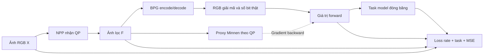

# NPP + proxy Minnen cho nén ảnh phục vụ thị giác máy

Mã tái tạo pipeline chính của Lu và cộng sự, *Preprocessing Enhanced Image Compression for Machine Vision*, IEEE TCSVT 2024. Gồm huấn luyện proxy và NPP, mã hóa ảnh bằng BPG và đánh giá rate–task trên COCO hoặc ImageNet. [Bài báo](https://doi.org/10.1109/TCSVT.2024.3441049) · [Mã tác giả, commit được đối chiếu](https://github.com/XingtongGe/PreprocessingICM/tree/6a77c4633cd5bb6750c77ea9d213d38ffc88ee7a)

## Thuật toán



**NPP.** Nhánh nông dùng hai convolution `1×1` với 3 kênh, xử lý từng pixel. Nhánh sâu dùng U‑Net có skip concat, với 4 mức `32 → 64 → 128 → 256` và một block 512 kênh ở đáy. Cộng RGB của hai nhánh và clamp về `[0, 1]`. Bản adaptive có 8 cổng nhân theo kênh, mỗi cổng là MLP hai lớp. Khởi tạo cổng bằng 1 để checkpoint fixed và adaptive mới chuyển có cùng đầu ra.

**Proxy.** Quy trình khởi tạo từ `mbt2018` MSE pretrained của CompressAI rồi fine-tune theo từng QP BPG. Analysis/GDN tạo latent `y`, hyper-analysis tạo `z`. Hyperprior và masked convolution dự đoán phân phối của `y`. Tổng `−log₂ p` trên likelihoods của `y` và `z` chia cho số pixel đầu vào cho ra `Rₚ`. NPP dùng proxy ở chế độ train để nhận gradient qua lượng tử hóa mềm, với trọng số proxy đóng băng. [Minnen et al. 2018](https://arxiv.org/abs/1809.02736) · [CompressAI model zoo](https://interdigitalinc.github.io/CompressAI/zoo.html)

**Algorithm 1.** Với ảnh lọc `F = NPP(X, QP)`, chạy BPG để lấy `(X̂, Rₜ)` và proxy để lấy `(Ŷ, Rₚ)`. Dùng `v = X̂ + (Ŷ − stopgrad(Ŷ))` và `r = Rₜ + (Rₚ − stopgrad(Rₚ))`. Forward cho `v = X̂` và `r = Rₜ`. Backward cho đạo hàm của `Ŷ` và `Rₚ` theo `F`. Loss là `r + λ · Ltask(v) + 0.5 · MSE(X, F)`. FCOS dùng tổng loss của detector, ResNet‑50 dùng cross-entropy. Chỉ Adam của NPP cập nhật trọng số ở hai giai đoạn NPP.

**Suy luận.** Phía gửi chạy NPP và BPG encoder. Bitstream là `.bpg` chuẩn, chứa payload được tính rate. Phía nhận chạy `bpgdec` và mô hình downstream trên RGB đã giải mã. [BPG 0.9.8](https://bellard.org/bpg/)

### Cấu hình theo bài báo

| BPG QP | 28 | 31 | 34 | 37 | 41 | 44 |
|---|---:|---:|---:|---:|---:|---:|
| λₚ, Bảng I | 4096 | 2048 | 1024 | 512 | 256 | 128 |
| λ cho task, mục IV-A | 0.5 | 1 | 2 | 4 | 8 | — |

| Giai đoạn | Đầu vào và loss | Bước mặc định | Giảm LR |
|---|---|---:|---:|
| Proxy theo QP | Flickr crop `256×256`, `Rₚ + λₚ · MSE(Ŷ, X̂BPG)` | 400.000 | 320.000 |
| NPP fixed | COCO hoặc ImageNet, mặc định QP 34, Algorithm 1 | 120.000 | 80.000 |
| NPP adaptive | Khởi tạo từ fixed, lấy ngẫu nhiên một QP trong `28/31/34/37/41` mỗi bước | 100.000 | 60.000 |

LR Adam bắt đầu `1e-4`, giảm xuống `1e-5`. CLI mặc định áp dụng lịch 400.000 bước riêng cho mỗi proxy. Mục IV-A công bố số bước của giai đoạn proxy và để ngỏ cách phân bổ giữa các QP. `--steps`, `--decay`, `--batch-size` và `--seed` cho phép ghi rõ cấu hình chạy. Checkpoint giữ model, optimizer, bước, cấu hình và vị trí lấy mẫu. Khi dùng `--resume`, `--steps` là tổng số bước đích. Giữ nguyên `--decay` khi chia giai đoạn thành nhiều phiên.

Mỗi epoch duyệt một hoán vị ngẫu nhiên của dữ liệu. Với cùng tập train, annotation và seed, adaptive bắt đầu tại vị trí fixed đã đi tới. Khi hết một epoch, epoch tiếp theo lấy hoán vị mới. Cách lấy mẫu này tránh lặp lại dãy fixed ở đầu adaptive và có thể tiếp tục đúng vị trí từ checkpoint. Checkpoint cũ tiếp tục theo cơ chế lấy mẫu đã dùng khi tạo checkpoint.

### Các quyết định tái tạo

- Các lớp NPP bám theo mã tác giả, gồm convolution stride 2 và batch normalization. Hình 3 minh họa max-pool. Đếm từ mã là 9.422.235 tham số fixed và 9.461.537 tham số adaptive.
- MLP nhận `QP/51` theo mô tả đầu vào QP của bài báo. Mã phát hành dùng `λ_task/8` và lịch QP riêng. Trọng số QA đã học theo lịch kia cần đúng quy ước đầu vào khi chạy lại.
- Mã công khai của tác giả có định nghĩa `ImageCompressor(192,192)` và hướng dẫn huấn luyện. Bản tái tạo dùng `mbt2018` làm khởi tạo công khai thay thế. CLI vẫn nhận bank checkpoint Minnen native của lần thử trước để đối chiếu. [Mã công khai của tác giả](https://github.com/XingtongGe/PreprocessingICM/tree/6a77c4633cd5bb6750c77ea9d213d38ffc88ee7a)
- Task model dùng checkpoint TorchVision. COCO mã hóa ảnh gốc rồi dùng resize của detector trên ảnh giải mã. ImageNet mã hóa crop `224×224`, với random-resized crop khi train và resize cạnh ngắn 256 rồi center crop khi eval. Chuẩn hóa ImageNet chỉ thực hiện phía task model. [TorchVision model zoo](https://docs.pytorch.org/vision/0.20/models.html)
- U‑Net pad đến bội 16, proxy pad đến bội 64, rồi crop về kích thước đầu vào. BPG nhận RGB 8 bit sau làm tròn. Rate BPG lấy từ số byte file, gồm header. Bản pilot Kaggle dùng BPG JCTVC ở level 1. Quy trình này dùng level 8 mặc định của libbpg 0.9.8, phù hợp với cách mã tác giả gọi BPG mà không truyền `-m`. Dùng cùng binary và level cho calibration, fine-tune, train NPP và đánh giá. [BPG 0.9.8](https://bellard.org/bpg/)

## Chạy

Cài Python 3.10–3.12 và cặp PyTorch/TorchVision trong `requirements.txt`. Để dùng GPU, cài wheel CUDA phù hợp với máy. Cài `bpgenc` và `bpgdec` từ bản libbpg chính thức rồi thêm vào `PATH` hoặc truyền đường dẫn qua `--bpgenc` và `--bpgdec`. Kiểm tra hai chương trình BPG chạy được từ terminal, đặc biệt với bản Windows. [Tải BPG](https://bellard.org/bpg/)

```powershell
python -m pip install -r requirements.txt
python -m npp_proxy --help
python -m unittest discover -s tests -v
python -m npp_proxy encode --input input.png --qp 34 --output runs/sample.bpg --decoded runs/sample.png
```

Dùng `encode --npp checkpoints/adaptive.pt` để lọc trước khi tạo bitstream. Test tích hợp BPG chạy khi hai chương trình có trong `PATH`.

### 1. Proxy trên Flickr

Đặt ảnh trong `data/flickr/train` và dành riêng ảnh khác trong `data/flickr/holdout`. Cài `requirements-pretrained.txt` trên Kaggle/Linux. Lần đầu chạy calibration cần Internet hoặc cache trọng số CompressAI. Trên Windows, CompressAI 1.2.8 cần build từ nguồn. [Các gói CompressAI 1.2.8](https://pypi.org/project/compressai/1.2.8/#files)

Calibration lấy 64 ảnh holdout theo seed, mỗi ảnh một crop `256×256`. Với mỗi QP, chọn mức `mbt2018` có PSNR trung bình gần BPG nhất trên đúng các crop đó, rồi lưu PSNR, bpp và danh sách ảnh vào JSON. Bài báo mô tả chọn khởi tạo có chất lượng tái tạo tương đương BPG. PSNR trung bình và số ảnh holdout là quy ước của bản tái tạo.

```powershell
python -m pip install -r requirements-pretrained.txt
python -m npp_proxy calibrate-proxy --data data/flickr/holdout --output checkpoints/calibration.json
foreach ($qp in 28,31,34,37,41) {
    python -m npp_proxy train-proxy --data data/flickr/train --qp $qp --batch-size 2 --calibration checkpoints/calibration.json --output "checkpoints/proxy/qp$qp.pt"
}
python -m npp_proxy audit-proxy --data data/flickr/holdout --proxy-dir checkpoints/proxy --output runs/proxy-audit.json
```

Audit đo PSNR, bpp ước lượng của proxy, bpp thật từ BPG, tỉ số hai rate và MSE giữa hai ảnh giải mã. Có thể chạy cùng lệnh với bank cũ và dùng cùng `--seed`, `--samples` để đối chiếu. Audit dùng lượng tử hóa xác định. Khi train, log `bpg_bpp`, `proxy_bpp` và `target_mse` cho phép theo dõi proxy trong chế độ nhiễu lượng tử. Các số đo audit mô tả mức khớp rate và ảnh giải mã.

Ảnh được lấy crop ngẫu nhiên mỗi lần đọc. Ví dụ dùng batch 2, tương ứng 800.000 lượt crop mỗi QP ở 400.000 bước. Bài báo báo cáo tập Flickr khoảng 800.000 crop. Số ảnh nguồn, crop, checkpoint khởi tạo và budget thực tế cần ghi cùng kết quả. `--pretrained-quality` dùng khi đã xác định được mức khởi tạo bằng phép đo riêng. QP 44 có λₚ trong Bảng I và có thể thêm bằng `--qps 28 31 34 37 41 44` khi hiệu chỉnh và `--qp 44` khi train.

### Chia phiên trên Kaggle

Clone nhánh mã nguồn vào `/kaggle/working`, thêm hai binary BPG Linux vào `PATH` và mount dữ liệu. Nếu notebook dùng Python 3.13, tạo môi trường Python 3.12 với `uv` trước khi cài `requirements-pretrained.txt`. Ví dụ với accelerator GPU có driver tương thích CUDA 12.1, chạy đoạn sau trong thư mục repo. [Wheel PyTorch 2.5.1](https://pytorch.org/get-started/previous-versions/#v251)

```bash
uv venv --python 3.12 /tmp/npp-venv
source /tmp/npp-venv/bin/activate
uv pip install --index-url https://download.pytorch.org/whl/cu121 torch==2.5.1 torchvision==0.20.1
uv pip install -r requirements-pretrained.txt
```

Mỗi QP proxy là một job độc lập. Dùng cùng calibration JSON cho tất cả QP. Nếu đường dẫn holdout thay đổi giữa máy tạo JSON và Kaggle, truyền `--calibration-root` với đường dẫn holdout hiện tại.

Ví dụ một QP chạy hai phiên, với đường dẫn train ổn định giữa hai notebook và checkpoint phiên trước được gắn làm input cho phiên sau. Điều chỉnh mốc 5.000/10.000 sau khi đo thời gian mỗi bước. Tiếp tục theo lịch mặc định cho tới 400.000 bước.

```bash
python -m npp_proxy train-proxy --data /kaggle/input/flickr/train --qp 34 --batch-size 2 \
  --calibration /kaggle/input/calibration/calibration.json --steps 5000 \
  --output /kaggle/working/qp34.pt

python -m npp_proxy train-proxy --data /kaggle/input/flickr/train --qp 34 --batch-size 2 \
  --resume /kaggle/input/previous-run/qp34.pt --steps 10000 \
  --output /kaggle/working/qp34.pt
```

Mỗi phiên cần kết thúc bình thường để checkpoint được lưu trong output của Kaggle. Với fixed và adaptive, chia phiên tương tự bằng `--resume` và giữ nguyên đường dẫn mount của bank proxy. Lần đầu chạy adaptive, truyền `--fixed` trỏ đến checkpoint đã train đủ 120.000 bước. Sau khi resume, metadata checkpoint adaptive khôi phục vị trí lấy mẫu. Checkpoint phiên cuối của mỗi QP đặt tại `checkpoints/proxy/qp<QP>.pt` trước khi train NPP.

### 2. NPP trên COCO hoặc ImageNet

```powershell
python -m npp_proxy train-npp --stage fixed --task detection --data data/coco/train2017 --annotations data/coco/annotations/instances_train2017.json --proxy-dir checkpoints/proxy --output checkpoints/od-fixed.pt
python -m npp_proxy train-npp --stage adaptive --task detection --data data/coco/train2017 --annotations data/coco/annotations/instances_train2017.json --proxy-dir checkpoints/proxy --fixed checkpoints/od-fixed.pt --output checkpoints/od-adaptive.pt

python -m npp_proxy train-npp --stage fixed --task classification --data data/imagenet/train --proxy-dir checkpoints/proxy --output checkpoints/ic-fixed.pt
python -m npp_proxy train-npp --stage adaptive --task classification --data data/imagenet/train --proxy-dir checkpoints/proxy --fixed checkpoints/ic-fixed.pt --output checkpoints/ic-adaptive.pt
```

COCO dùng ảnh và annotation 2017. ImageNet cần các split `train/<WNID>/...` và `val/<WNID>/...` với đủ 1.000 thư mục lớp để thứ tự label khớp checkpoint. Lần đầu TorchVision tải checkpoint công khai nếu thiếu cache. Có thể dùng `--task-weights path/to/weights.pth` cho checkpoint TorchVision lưu sẵn. Dùng `--proxy-only` trong cả hai giai đoạn NPP để kiểm tra ablation proxy forward và backward, sau đó vẫn đánh giá bằng BPG.

### 3. Đánh giá BPG so với NPP+BPG

```powershell
python -m npp_proxy evaluate --task detection --data data/coco/val2017 --annotations data/coco/annotations/instances_val2017.json --npp checkpoints/od-adaptive.pt --output runs/coco-fcos
python -m npp_proxy evaluate --task classification --data data/imagenet/val --npp checkpoints/ic-adaptive.pt --output runs/imagenet-resnet50
```

Hai phương pháp được đánh giá trên cùng ảnh, QP, cấu hình BPG và trọng số downstream. Có thể kiểm tra checkpoint fixed ở QP 34 với `--qps 34 --limit 32` trước khi chạy adaptive. Dùng `--backbone faster-rcnn`, `retinanet`, `swin-t` hoặc `vit-b16` để đánh giá chuyển backbone trong cùng task. Khi báo cáo theo bài, đánh giá toàn bộ validation và bỏ `--limit`.

`rate_task.csv` chứa mean bpp theo ảnh, pooled bpp, COCO AP@[.50:.95] hoặc ImageNet top‑1, và MSE RGB do NPP gây ra trước encode. `summary.json` lưu cấu hình và BD-rate theo khoảng chất lượng chung, với kết quả cubic và PCHIP. Điểm bị trội và điểm trùng chất lượng bị loại trước khi nội suy. Thiếu bốn điểm hợp lệ mỗi đường hoặc thiếu khoảng chung thì BD-rate là `null`.

## Phạm vi kết quả

Kiểm thử với ảnh tổng hợp kiểm tra BPG thật, byte bitstream, công thức forward/backward, đóng băng proxy và task, và chuyển checkpoint fixed sang adaptive. Chạy đủ lịch Flickr/COCO/ImageNet và đánh giá đủ 5.000/50.000 ảnh là phần cần thực hiện để đối chiếu các mốc BD-rate −20,3% FCOS và −22,5% ResNet‑50 mà bài báo công bố. Các thí nghiệm phụ JPEG/VVC, LPIPS, phân đoạn và pose thuộc phạm vi mở rộng của bài báo. [Kết quả công bố, mục IV](https://doi.org/10.1109/TCSVT.2024.3441049)

Phần kiến trúc PyTorch được chỉnh từ PreprocessingICM theo Apache‑2.0, gồm tách phụ thuộc MMDetection khỏi lõi, bỏ giả định CUDA, xử lý padding và dùng phép ghép forward/backward an toàn với autograd. [Giấy phép upstream](https://github.com/XingtongGe/PreprocessingICM/blob/6a77c4633cd5bb6750c77ea9d213d38ffc88ee7a/LICENSE)
