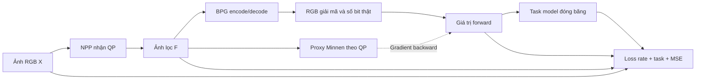

# NPP + proxy Minnen cho nén ảnh phục vụ thị giác máy

Mã tái tạo pipeline chính của Lu và cộng sự, *Preprocessing Enhanced Image Compression for Machine Vision*, IEEE TCSVT 2024. Gồm huấn luyện proxy và NPP, mã hóa ảnh bằng BPG và đánh giá rate–task trên COCO hoặc ImageNet. [Bài báo](https://doi.org/10.1109/TCSVT.2024.3441049) · [Mã tác giả, commit được đối chiếu](https://github.com/XingtongGe/PreprocessingICM/tree/6a77c4633cd5bb6750c77ea9d213d38ffc88ee7a)

## Thuật toán



**NPP.** Nhánh nông dùng hai convolution `1×1` với 3 kênh, xử lý từng pixel. Nhánh sâu dùng U‑Net có skip concat, với 4 mức `32 → 64 → 128 → 256` và một block 512 kênh ở đáy. Cộng RGB của hai nhánh và clamp về `[0, 1]`. Bản adaptive có 8 cổng nhân theo kênh, mỗi cổng là MLP hai lớp. Khởi tạo cổng bằng 1 để checkpoint fixed và adaptive mới chuyển có cùng đầu ra.

**Proxy.** Minnen với 192 kênh theo mã tác giả. Analysis/GDN tạo latent `y`, hyper-analysis tạo `z`. Hyperprior và masked convolution dự đoán trung bình, scale của Gaussian cho `y`; CDF học được mô hình hóa `z`. Tổng `−log₂ p` của hai latent chia cho số pixel đầu vào cho ra `Rₚ`. Đặt proxy ở chế độ nhiễu lượng tử đều `U(−0.5, 0.5)` khi tính gradient, kể cả khi các trọng số đã đóng băng. [Minnen et al. 2018](https://arxiv.org/abs/1809.02736)

**Algorithm 1.** Với ảnh lọc `F = NPP(X, QP)`, chạy BPG để lấy `(X̂, Rₜ)` và proxy để lấy `(Ŷ, Rₚ)`. Dùng `v = X̂ + (Ŷ − stopgrad(Ŷ))` và `r = Rₜ + (Rₚ − stopgrad(Rₚ))`. Forward cho `v = X̂` và `r = Rₜ`. Backward cho đạo hàm của `Ŷ` và `Rₚ` theo `F`. Loss là `r + λ · Ltask(v) + 0.5 · MSE(X, F)`. FCOS dùng tổng loss của detector, ResNet‑50 dùng cross-entropy. Chỉ Adam của NPP cập nhật trọng số ở hai giai đoạn NPP.

**Suy luận.** Phía gửi chạy NPP và BPG encoder. Bitstream là `.bpg` chuẩn, chứa payload được tính rate. Phía nhận chạy `bpgdec` và mô hình downstream trên RGB đã giải mã. [BPG 0.9.8](https://bellard.org/bpg/)

### Cấu hình theo bài báo

| BPG QP | 28 | 31 | 34 | 37 | 41 | 44 |
|---|---:|---:|---:|---:|---:|---:|
| λₚ, Bảng I | 4096 | 2048 | 1024 | 512 | 256 | 128 |
| λ cho task, mục IV-A | 0.5 | 1 | 2 | 4 | 8 | — |

| Giai đoạn | Đầu vào và loss | Bước mặc định | Giảm LR |
|---|---|---:|---:|
| Proxy theo QP | Flickr crop `256×256`, `Rₚ + λₚ · MSE(Ŷ, X̂BPG)` | 400.000 | 320.000 |
| NPP fixed | COCO hoặc ImageNet, mặc định QP 34, Algorithm 1 | 120.000 | 80.000 |
| NPP adaptive | Khởi tạo từ fixed, lấy ngẫu nhiên một QP trong `28/31/34/37/41` mỗi bước | 100.000 | 60.000 |

LR Adam bắt đầu `1e-4`, giảm xuống `1e-5`. CLI mặc định áp dụng lịch 400.000 bước riêng cho mỗi proxy. Mục IV-A công bố số bước của giai đoạn proxy và để ngỏ cách phân bổ giữa các QP. `--steps`, `--decay`, `--batch-size` và `--seed` cho phép ghi rõ cấu hình chạy. Checkpoint giữ model, optimizer, bước và cấu hình. Khi dùng `--resume`, `--steps` là tổng số bước đích.

### Các quyết định tái tạo

- Các lớp NPP bám theo mã tác giả, gồm convolution stride 2 và batch normalization. Hình 3 minh họa max-pool. Đếm từ mã là 9.422.235 tham số fixed và 9.461.537 tham số adaptive.
- MLP nhận `QP/51` theo mô tả đầu vào QP của bài báo. Mã phát hành dùng `λ_task/8` và lịch QP riêng. Trọng số QA đã học theo lịch kia cần đúng quy ước đầu vào khi chạy lại.
- Proxy bản này bám theo lớp và định dạng `state_dict` của `ImageCompressor(192,192)` từ tác giả. Checkpoint `mbt2018` của CompressAI và bank QP `30/35/40/45` từ lần thử cũ thuộc đường tái tạo riêng.
- Task model dùng checkpoint TorchVision. COCO mã hóa ảnh gốc rồi dùng resize của detector trên ảnh giải mã. ImageNet mã hóa crop `224×224`, với random-resized crop khi train và resize cạnh ngắn 256 rồi center crop khi eval. Chuẩn hóa ImageNet chỉ thực hiện phía task model. [TorchVision model zoo](https://docs.pytorch.org/vision/0.20/models.html)
- U‑Net pad đến bội 16, proxy pad đến bội 64, rồi crop về kích thước đầu vào. BPG nhận RGB 8 bit sau làm tròn. Rate BPG lấy từ số byte file, gồm header.

## Chạy

Cài Python 3.10+ và cặp PyTorch/TorchVision trong `requirements.txt`. Để dùng GPU, cài wheel CUDA phù hợp với máy. Cài `bpgenc` và `bpgdec` từ bản libbpg chính thức rồi thêm vào `PATH` hoặc truyền đường dẫn qua `--bpgenc` và `--bpgdec`. Kiểm tra hai chương trình BPG chạy được từ terminal, đặc biệt với bản Windows. [Tải BPG](https://bellard.org/bpg/)

```powershell
python -m pip install -r requirements.txt
python -m npp_proxy --help
python -m unittest discover -s tests -v
python -m npp_proxy encode --input input.png --qp 34 --output runs/sample.bpg --decoded runs/sample.png
```

Dùng `encode --npp checkpoints/adaptive.pt` để lọc trước khi tạo bitstream. Test tích hợp BPG chạy khi hai chương trình có trong `PATH`.

### 1. Proxy trên Flickr

Đặt ảnh train trong `data/flickr/train`. Dùng checkpoint Minnen tương thích cho từng điểm RD nếu có. Khi thiếu checkpoint khởi tạo, có thể pretrain với `--target source`, tức tối ưu RD trên ảnh nguồn, rồi chuyển sang fine-tune với target BPG. `--from-scratch` dùng cho thử nghiệm khởi tạo ngẫu nhiên trực tiếp trên target BPG.

```powershell
foreach ($qp in 28,31,34,37,41) {
    python -m npp_proxy train-proxy --data data/flickr/train --qp $qp --target source --output "checkpoints/init/qp$qp.pt"
    python -m npp_proxy train-proxy --data data/flickr/train --qp $qp --init "checkpoints/init/qp$qp.pt" --output "checkpoints/proxy/qp$qp.pt"
}
```

Ảnh được lấy crop ngẫu nhiên mỗi bước. Bài báo dùng khoảng 800.000 crop Flickr cho giai đoạn proxy. Số ảnh nguồn, crop, checkpoint khởi tạo và budget thực tế phải được ghi cùng kết quả. QP 44 có λₚ trong Bảng I và có thể fit riêng bằng `--qp 44`.

### 2. NPP trên COCO hoặc ImageNet

```powershell
python -m npp_proxy train-npp --stage fixed --task detection --data data/coco/train2017 --annotations data/coco/annotations/instances_train2017.json --proxy-dir checkpoints/proxy --output checkpoints/od-fixed.pt
python -m npp_proxy train-npp --stage adaptive --task detection --data data/coco/train2017 --annotations data/coco/annotations/instances_train2017.json --proxy-dir checkpoints/proxy --fixed checkpoints/od-fixed.pt --output checkpoints/od-adaptive.pt

python -m npp_proxy train-npp --stage fixed --task classification --data data/imagenet/train --proxy-dir checkpoints/proxy --output checkpoints/ic-fixed.pt
python -m npp_proxy train-npp --stage adaptive --task classification --data data/imagenet/train --proxy-dir checkpoints/proxy --fixed checkpoints/ic-fixed.pt --output checkpoints/ic-adaptive.pt
```

COCO dùng ảnh và annotation 2017. ImageNet cần các split `train/<WNID>/...` và `val/<WNID>/...` với đủ 1.000 thư mục lớp để thứ tự label khớp checkpoint. Lần đầu TorchVision tải checkpoint công khai nếu thiếu cache. Có thể dùng `--task-weights path/to/weights.pth` cho checkpoint TorchVision lưu sẵn. Dùng `--proxy-only` trong cả hai giai đoạn NPP để kiểm tra ablation proxy forward và backward, sau đó vẫn đánh giá bằng BPG.

### 3. Đánh giá BPG so với NPP+BPG

```powershell
python -m npp_proxy evaluate --task detection --data data/coco/val2017 --annotations data/coco/annotations/instances_val2017.json --npp checkpoints/od-adaptive.pt --output runs/coco-fcos
python -m npp_proxy evaluate --task classification --data data/imagenet/val --npp checkpoints/ic-adaptive.pt --output runs/imagenet-resnet50
```

Hai phương pháp được đánh giá trên cùng ảnh, QP, cấu hình BPG và trọng số downstream. Dùng `--backbone faster-rcnn`, `retinanet`, `swin-t` hoặc `vit-b16` để đánh giá chuyển backbone trong cùng task. `--qps 34 --limit 8` là cấu hình kiểm tra ngắn.

`rate_task.csv` chứa mean bpp theo ảnh, pooled bpp, COCO AP@[.50:.95] hoặc ImageNet top‑1. `summary.json` lưu cấu hình và BD-rate theo khoảng chất lượng chung, với kết quả cubic và PCHIP. Điểm bị trội và điểm trùng chất lượng bị loại trước khi nội suy. Thiếu bốn điểm hợp lệ mỗi đường hoặc thiếu khoảng chung thì BD-rate là `null`.

## Phạm vi kết quả

Kiểm thử với ảnh tổng hợp kiểm tra BPG thật, byte bitstream, công thức forward/backward, đóng băng proxy và task, và chuyển checkpoint fixed sang adaptive. Chạy đủ lịch Flickr/COCO/ImageNet và đánh giá đủ 5.000/50.000 ảnh là phần cần thực hiện để đối chiếu các mốc BD-rate −20,3% FCOS và −22,5% ResNet‑50 mà bài báo công bố. Các thí nghiệm phụ JPEG/VVC, LPIPS, phân đoạn và pose thuộc phạm vi mở rộng của bài báo. [Kết quả công bố, mục IV](https://doi.org/10.1109/TCSVT.2024.3441049)

Phần kiến trúc PyTorch được chỉnh từ PreprocessingICM theo Apache‑2.0, gồm tách phụ thuộc MMDetection khỏi lõi, bỏ giả định CUDA, xử lý padding và dùng phép ghép forward/backward an toàn với autograd. [Giấy phép upstream](https://github.com/XingtongGe/PreprocessingICM/blob/6a77c4633cd5bb6750c77ea9d213d38ffc88ee7a/LICENSE)
